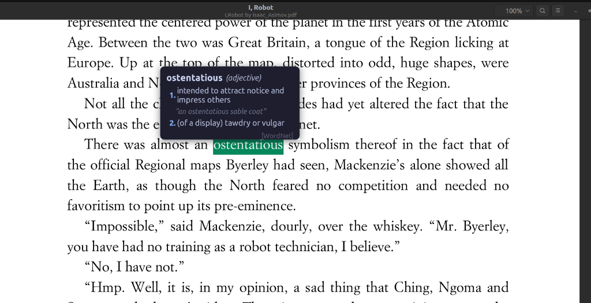
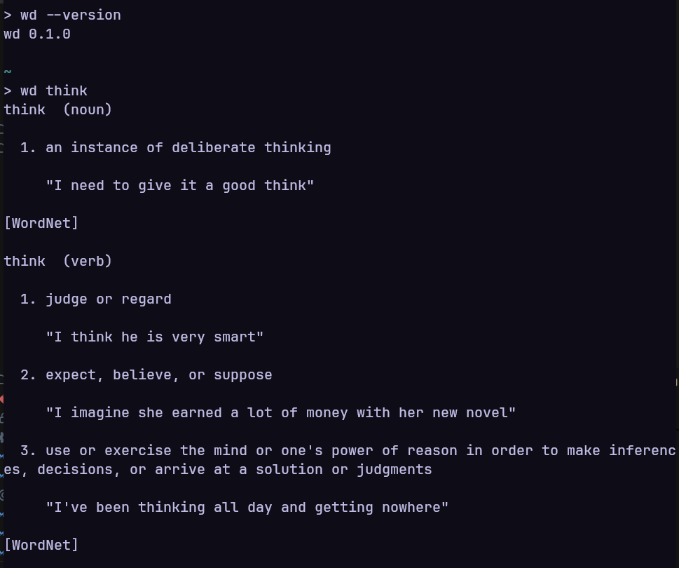

# wd

A lightweight word-lookup daemon and CLI tool for Linux.

## Project History

This project started purely for personal convenience. As someone who reads a lot of digital books and PDFs on my laptop, I wanted a tool that would automatically display definitions for highlighted words *without* needing to press manual keyboard shortcuts or interrupt my reading flow.

As a beginner to Rust, I built this tool side-by-side with AI assistants. Because this is a learning journey and a hobby project, simplicity is a core value here. I hope others find it useful, and I will try to address every issue or feature request that comes along!

## Features

- **CLI mode** — Type `wd <word>` and get a clean, formatted definition instantly
- **Daemon mode** — Runs silently in the background:
  - Auto-detects text selection in PDF viewers (Papers/Evince/Okular) and shows a popup
  - Global hotkey (`Ctrl+Alt+W`) to look up the current text selection from any app
- **Offline-first** — Uses a local WordNet database via instant memory mappings (`mmap`) with automatic Wiktionary fallback
- **Lightweight** — Under 4 MB RAM at idle, zero CPU between lookups

## Preview

### PDF Auto-Lookup & Popup


### CLI Mode


## Install

### From source

```bash
# Install build dependencies
sudo apt install libgtk-4-dev libdbus-1-dev

# Build
cargo build --release

# Install binary
sudo cp target/release/wd /usr/bin/wd

# Configure desktop autostart (starts automatically upon desktop login)
mkdir -p ~/.config/autostart
cp debian/wd.desktop ~/.config/autostart/

# Or run the daemon immediately in the background
wd --daemon &
```

### From .deb package

```bash
sudo apt install ./wd_*.deb
```

### WordNet data

wd works best with WordNet installed locally:

```bash
sudo apt install wordnet-base
```

If `wordnet-base` is not installed, the post-install script downloads the data automatically.

## Usage

### CLI

```bash
# Look up a word
wd think

# Output:
# think  (verb)
#
#   1. Judge or regard; look upon; judge.
#
#      "She thinks he is a saint"
#
#   2. Expect, believe, or suppose.
#
#      "I thought to find her in a bad state"
#
#   3. Use or exercise the mind or one's power of reason.
#
#      "Think before you speak"
#
# [WordNet]
```

### Daemon

```bash
# Start the daemon in background
wd --daemon &

# When installed via package or autostart desktop entry,
# the daemon starts automatically every time you log in to your desktop.
```

## Hotkeys

| Hotkey | Action |
|--------|--------|
| `Ctrl+Alt+W` | Look up the current text selection |
| `Escape` | Dismiss the popup |

## Configuration

Edit `~/.config/wd/config.toml` (created with helpful defaults on first run):

```toml
# General settings
lookup_hotkey = "Ctrl+Alt+W"
pdf_auto_trigger = true
popup_timeout_ms = 0
popup_font_size = 13
max_definitions = 3

# Popup appearance & colors (HEX or CSS names)
popup_bg_color = "#1e1e2e"       # Window background
popup_text_color = "#bac2de"     # Definition description text
popup_header_color = "#cdd6f4"   # Word header title
popup_accent_color = "#89b4fa"   # Numbering (1., 2., 3.)
popup_border_color = "#45475a"   # Outline border
popup_example_color = "#6c7086"  # Example sentences & grammar label
```

> **Contrast Guarantee:** If you choose a light background (e.g. `popup_bg_color = "#ffffff"`), `wd` automatically verifies and enforces high-contrast readability for the text even if you leave the default text color.

## Lookup Resolution

1. Normalise input (lowercase, strip punctuation, trim)
2. Check local WordNet index (including morphological variants)
3. If not found, silently query Wiktionary REST API
4. Source label (`[WordNet]` or `[Wiktionary]`) shown in output

## Current Limitations & Known Issues

`wd` currently relies on X11 APIs (via `x11rb`) for global hotkeys, window identification, and popup placement. Because of this, using it under **Wayland** introduces several characteristics:

1. **Wayland Global Hotkeys**: On strict Wayland compositors (like GNOME), global hotkeys (`Ctrl+Alt+W`) will only fire if an X11/XWayland window is currently in focus. Less restrictive compositors (like KDE Plasma) usually allow global X11 shortcuts out-of-the-box.
2. **Wayland PDF Viewer Compatibility**: To auto-trigger lookups on highlighted text under Wayland, PDF viewers (like Papers, Evince, or Okular) must run under XWayland. The daemon automatically handles this on startup by creating user-local launcher overrides under `~/.local/share/applications/` to force these PDF viewers to use the X11 backend (`GDK_BACKEND=x11` for Papers/Evince, `QT_QPA_PLATFORM=xcb` for Okular).
3. **Cursor Snapping**: The definition popup snaps centered directly above the cursor/selection, clamping within screen boundaries. If the selection is at the very top of the screen, the popup automatically shifts below the cursor. **For cursor snapping to work cleanly, the daemon must run with `GDK_BACKEND=x11`.**
4. **Linux Only**: Coupled to D-Bus, X11, and Linux filesystem structures.

## Contributing

Contributions are incredibly welcome! If you enjoy system-level Rust programming, feel free to dive in and open a PR. Since this is a learning project, please write precise reasons in your PR or code comments explaining your changes.

**Open Issues you can help solve:**
- **Native Wayland Selection Watcher:** Implement a Wayland-native text selection monitor (e.g., using the `wlr-data-control` protocol) to replace the current `XFixes` dependency. 
- **Wayland Global Hotkeys:** Support Wayland global shortcuts (e.g., via the `xdg-desktop-portal` `GlobalShortcuts` interface) instead of X11-specific global keyboard grabs.
- **GTK4 Notification Placement:** Find a clean, native approach to placing GTK4 popup windows precisely at the cursor coordinates within a strict Wayland environment (perhaps via the GTK Layer Shell).
- **PDF Annotation Support:** Introduce PDF annotations via a robust backend like `libpoppler` to embed dictionary metadata directly into the underlying `.pdf` files, systematically bypassing the unsupported D-Bus viewer APIs we previously relied on.

## License

MIT
